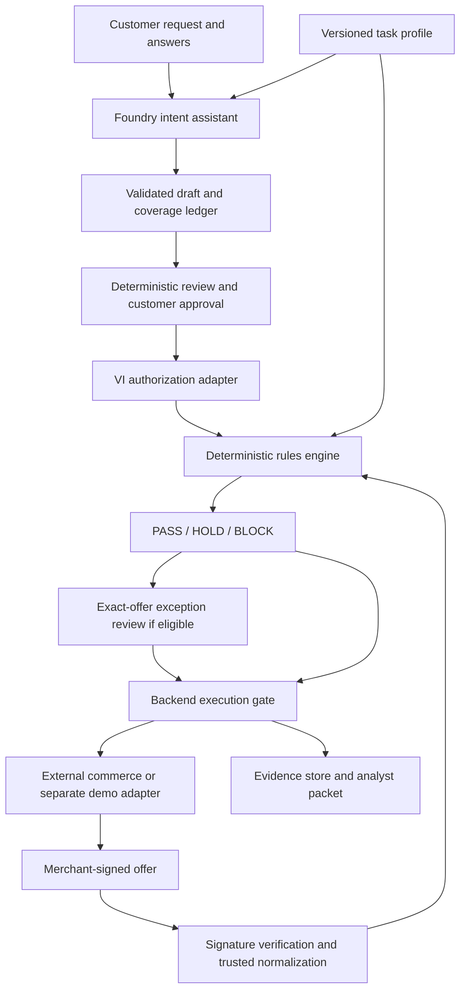

# Proposed architecture

## Design choice

Use one small backend with a reusable workflow, declarative task profiles, an explicit VI adapter, and interchangeable commerce adapters. A prompt-only wrapper cannot reliably enforce purchase semantics; a separate application per domain duplicates the consent, evidence, and execution logic.

The configured core is the recommended middle path. Most new fields can use existing typed operators. New calculations or provider integrations require a focused adapter or validator, rather than a rewritten application.

Keep Python 3.11+, FastAPI, Pydantic v2, Uvicorn, and pytest. Use one static HTML/JS/CSS page for the demo. Use a Foundry-hosted model through the project's configured `openai` client. No multi-agent runtime or separate agent framework is required for the first build.

## Components



The VI adapter returns detailed cryptographic/native constraint findings; only `rules_engine.py` emits the application decision. Backend purchase enforcement consumes the structured decision and authoritative acceptance records.

## Proposed module layout

```text
app/
  main.py                   # API and static web serving
  models.py                 # Typed internal contracts
  intent_service.py         # Clarification and coverage workflow
  foundry_client.py          # Draft/explain/narrative calls and mock fallback
  profile_registry.py        # Validate, pin, and load trusted profiles
  rules_engine.py            # Pure deterministic decision and domain checks
  vi_adapter.py              # Actual VI issuance, verification, composition
  offer_adapter.py           # Verified payload normalization
  purchase_service.py        # Atomic execution authorization and idempotency
  evidence.py                # Factual evidence packet
  store.py                   # Consent, versions, decisions, exceptions, receipts
  commerce/base.py           # Narrow discovery/execution interface
profiles/                    # Flight and hotel configuration
demo/                        # Synthetic catalog, merchant signing, fake execution
web/                         # index.html, app.js, styles.css
tests/                       # Rules, VI integration, enforcement, injection, scenarios
docs/                        # This documentation
```

This is a proposal, not a list of files already implemented. Keep demo data generation and simulated purchases out of the domain/rules modules. The core may call an injected commerce interface; it must not import a hardcoded flight catalog.

## Data contracts

| Object | Essential content |
|---|---|
| `IntentDraft` | Conversation revision, profile identity, typed field proposals, coverage ledger, questions, unsupported conditions |
| `ApprovedRequirements` | ID/revision/digest, profile identity/digest, specified values, explicit no-preference choices, approval identity/time |
| `VerifiedOffer` | Original checkout JWT and hash, signer identity/key ID, validity interval, signed facts, normalized fields and field provenance |
| `VerificationFindings` | Chain/binding/native check outcomes, performed/skipped/delegated responsibilities, unsupported capabilities |
| `Decision` | ID, requirement/profile/offer digests, PASS/HOLD/BLOCK, structured checks and non-waivable gate failures |
| `ExceptionAcceptance` | Exact decision/check/value or unknown state, offer and approval bindings, actor/time, signed authorization reference |
| `PurchaseReceipt` | Checked checkout hash, execution/idempotency ID, amount/currency, adapter mode, outcome/time |
| `EvidencePacket` | References to immutable inputs and events, verification details, accepted exceptions, receipt, analyst boundary |

Do not trust hashes supplied by the client. Compute them from stored canonical objects or the exact checkout JWT bytes. Hash equality supports identity and integrity; authenticated or cryptographic provenance establishes who approved or signed.

## Proposed API

| Endpoint | Responsibility |
|---|---|
| `GET /api/profiles` | Supported profile/version/capability manifest |
| `POST /api/intents` | Begin a draft from request text and selected profile |
| `POST /api/intents/{id}/answers` | Record answers/edits and create a new draft revision |
| `POST /api/intents/{id}/approve` | Approve an exact server-stored revision and issue signed authorization |
| `POST /api/check` | Verify supplied offer, evaluate pinned approved requirements |
| `POST /api/decisions/{id}/exceptions` | Record specific acceptance and obtain required authorization update |
| `POST /api/purchase` | Enforce and execute the exact authorized offer or return 409 |
| `GET /api/purchases/{id}/evidence` | Retrieve factual evidence with appropriate access control |
| `POST /api/disputes` | Create an analyst packet referencing a purchase; no liability judgment |

Public DTOs do not accept `approved=true`, a replacement approved requirement object, or client-computed PASS. Server records and verified signatures supply authority.

## Microsoft model boundary

The model performs three bounded jobs: extraction/clarification, decision explanation, and factual narrative. Validate every response with Pydantic and semantic checks, including source-span correctness and allowed fields/operators. Schema conformity does not prove interpretation accuracy.

Microsoft distinguishes structured outputs from JSON mode and documents a supported subset of JSON Schema. Prefer structured outputs when the selected deployment supports them; validate returned JSON either way. [Microsoft documentation](https://learn.microsoft.com/en-us/azure/foundry/openai/how-to/structured-outputs).

Use `AzureOpenAI` for the endpoint/API-version configuration in the standing project stack. If the chosen deployment requires a different supported endpoint shape, select that implementation only after checking its deployment details. Keep the provider implementation behind one client interface.

`MOCK_LLM=1` runs the full synthetic demo without network calls. Mock extraction supports explicit demo inputs and retains unresolved fields for unfamiliar requests. Explain/evidence templates remain deterministic. Model timeout or malformed output cannot auto-approve or invent a successfully completed extraction.

## Storage and integration boundary

Begin with a local store whose transaction interface supports approval revision checks and purchase idempotency. A process-local implementation is acceptable only for a labeled single-process demo and must document restart/data-loss limits. Persistent SQLite is an option when retaining evidence across restarts matters.

The deployment location is open: merchant-hosted, agent-platform-hosted, or a coordinated service. The first prototype uses one process to demonstrate all roles, with visibly synthetic keys and receipts. A future deployment requires actual wallet/issuer trust, merchant keys, session authentication, retention controls, and live checkout execution agreements.
