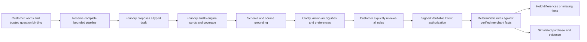

# Live reliability and independent acceptance testing

## Observed failure

The main app is `https://intent-judge-perfected.vercel.app/`. The original demo is only a visual/simplicity reference and is not part of this repair.

An independent tester, without repository access or a supplied happy path, entered: “I need to get from Newark to Tampa in early November for under $300 round trip, preferably nonstop, and I’d like to arrive in the morning.” The main app returned the generic validated-interpretation error and no conversation. The shared durable ledger had 103 lifetime reservations ($10.30 conservatively reserved), 40/40 interactive calls and 60/60 evaluation calls for October 13. Quota rejection was hidden by the same message used for provider, JSON and grounding failures. Retrying could not resolve that quota.

The technical audit also found: session counts changed before rejected global reservations; two-stage inference reserved each stage separately; first-stage validation prevented the audit from repairing malformed drafts; source quotations were checked for occurrence without stronger field-specific grounding; broad destinations and natural city names were poorly covered; and the conversation stopped after two follow-ups. These are separate findings, not a claim that quota explains every historical failure.

## Implementation boundaries

- Preserve the current static frontend, customer-approved requirements, deterministic backend rules, independently signed merchant facts, exact-offer exceptions and synthetic commerce adapter.
- Budget service reserves an entire interpretation before calling a provider. Rejections are typed and do not consume a session allowance. Production and test purposes remain distinguishable under the unchanged 200-call/$20 lifetime cap.
- Interpretation uses the original customer conversation, a typed draft, and a separate coverage audit. Only the final grounded, schema-valid draft reaches review. Neither model stage approves, signs or purchases.
- Public errors distinguish exhausted allowances, provider unavailability and interpretation validation. Provider secrets and raw failure payloads never appear in the public response.
- Clarification preserves the request and previous draft, supports useful natural replies, and exposes ambiguity and unsupported conditions rather than silently discarding them.
- UI retains the improved overview/tutorial direction, simplifies the working flow, and gives visible status, recovery and per-stage guidance.

## Separation of development and acceptance

Developers own implementation and provider-independent regression tests. Independent UAT agents choose their own requests and corrections through the visible browser UI, without source, fixtures or supplied click sequences. Their first pass is evidence of failures, not a developer-approved success script. Later passes will report exact requests, responses, friction and results against the actual deployed main app. Automated browser suites remain regression coverage, not the sole acceptance gate.

## Work and verification plan

1. Implement typed error and atomic budget accounting; test rejection, concurrency, whole-pipeline reservation and quota recovery.
2. Improve and measure interpretation/coverage/grounding; compare on development cases and keep fresh acceptance prompts separate.
3. Simplify conversational review and failure recovery; preserve every explicit approval and no-preference choice.
4. Run bounded real model experiments, provider-independent safety tests and desktop/mobile regressions.
5. Deploy the main project, then complete independent exploratory UAT with real Foundry interpretation and simulated checkout. Record remaining limitations and measured costs before completion.

This document is a working investigation record. Results below will be updated with actual evidence; planned checks are not passing checks.

## Architecture that now runs

The model envelope separates `fields`, exact `sources`, genuinely `unsupported` conditions, source-linked `clarifications`, and review guidance. “Florida” leaves the airport unresolved; “preferably nonstop” remains a preference to clarify. Round-trip and arrival-time requirements remain unsupported by the current flight profile. An audit may repair an invalid first proposal, but the final draft must pass grounding before it reaches the UI. Valid candidate requirements and clarifications cannot simply disappear in the audit. Short affirmative replies can ground only the actual matching trusted question; interface words cannot be quoted as customer evidence.

Across follow-ups, unresolved clarifications persist. When explicit customer words provide a value, the event record identifies the original quote and proposed interpretation. When the traveler reviews a remaining choice, the exact value or explicit no preference is recorded. Every proposal remains unapproved until the existing revision/digest-bound review and approval endpoints succeed.

The commerce adapter stays in `demo/fixtures.py`, separate from the interpretation, authorization and enforcement modules. Its signed offers and payments are synthetic; this is not a live shopping service. A real adapter must supply merchant-authenticated facts for the same reviewed profile. General mode currently demonstrates shared price policy and unsupported conditions; application-specific attributes still require an adopted domain profile.

## Measured experiments and retained failures

This repair used 39 additional conservative model-call reservations through the same durable ledger: 103 → 142, $10.30 → $14.20 reserved. Recorded reservations are not Azure billing. The lifetime 200-call/$20 cap and existing usage were retained. Daily interactive capacity changed to 80, session capacity to 16, and evaluation capacity to 100 so engineering tests and public use do not starve each other under that unchanged lifetime limit.

The new seven-case development corpus includes Florida as a question, natural city names, flexible nonstop/date preferences, ordinary connection/duration language, negation, a new hotel city, and a contradictory general shopping request. Earlier 4/7 and intermediate 5/7 reports are retained. Typed clarification labels separate clarifiable preferences from genuinely unsupported requirements; rescoring the actual stored outputs gives 6/7. Original labels and scores remain in that report, and no response was replaced or regenerated during rescoring.

The failing general request exposed loss of “comfortable” and “ethically made” when budget instructions conflicted. A subsequent two-call coverage repair preserved both conditions, but still did not emit the explicit budget clarification required by that case's gold labels (0/1). The required price remains missing, so review must supply a price and unsupported conditions hold checkout. This is a recorded model limitation, not a passing evaluation.

One native JSON Schema probe produced syntactically valid output but lost the subjective conditions and budget conflict. One medium-reasoning probe still lost the subjective conditions. These single-case probes do not establish a statistical model/configuration ranking. The selected production configuration remains the audited plain-JSON pipeline with low reasoning and strict application validation; actual traces record the prompt version, reasoning level, output format, usage and provider response IDs. No automatic model or parser fallback was enabled.

The saved actual responses were also evaluated in the native Foundry project using a deterministic Python grader. Original run: 4/7. Clarification-aware run: 6/7, with one failure retained. Neither native run invoked a target or judge model. See [native evaluation evidence](research/foundry-evaluation-probe.md). Quality now distinguishes historical reports, native evaluation results, live stage instrumentation and the bounded daily canary.

## Verification before hosted acceptance

Provider-independent verification is repeated after the UAT-driven changes below. Earlier counts (118 tests and six browser suites) were intermediate development checks, not hosted acceptance. The current runner includes eight browser suites; the last two deliberately intercept API responses to exercise races and UI guards and are labelled regression fixtures, not live inference.

## First hosted UAT failure and repair

The first independent live pass on source `5860987` entered this unscripted request:

> I’m visiting Tampa from Newark the first weekend of November, Nov 7–10. Keep the round trip under $300 total; one connection is okay, but I don’t want an overnight itinerary, and I’d prefer to land before dinner.

It failed with `ai_interpretation` (reference `799e80dd260b`). The tester explicitly selected offline mode afterward; those later steps do not count as a successful live intake. The offline origin suggestion repeated its question. Unsupported-only offer differences exposed an unusable acceptance action, and the deterministic explanation repeated a generic message without identifying each condition. Both signed offers correctly held checkout for unresolved conditions; no purchase was created.

Bounded developer reproductions retained the failures in `evals/experiments/`. Actual stage envelopes established two causes: a source quote changed the date's en dash into a non-breaking hyphen, and arrival/overnight conditions were assigned to fields that cannot enforce them. Another repetition proposed a clarification field outside the active profile. None of these failures is being erased from the record.

The grounding compiler now restores only typography-equivalent contiguous spans to the exact original customer text. Changed words, paraphrases and negation changes still fail. A quoted yearless date becomes a clarification rather than an invented year. Grounded conditions outside the profile remain unsupported; they cannot become an unrelated departure or duration rule and disappear through a no-preference choice. Unsupported conditions still hold checkout.

The offline parser now recognizes each explicit airport suggestion independently. UI review locks during pending clarification, and the backend refuses stale review/approval/purchase attempts while the same intent is changing. Duplicate explanatory requests are serialized and cached, and abandoned locks expire. Unsupported-only dialogs explain the hold without offering an empty acceptance. Deterministic explanations name each actual condition.

Developer experiments temporarily permit a few additional evaluation-purpose calls locally under the unchanged global 200-call/$20 cap. No usage counters were reset, public evaluation capacity was not increased, and the $10 emergency allowance remains disabled. Final live UAT and ledger totals are recorded after the completed release below.

Primary references: [Foundry cloud evaluation workflow](https://learn.microsoft.com/en-us/azure/foundry/observability/how-to/cloud-evaluation), [native evaluation configuration](https://ai.azure.com/api-reference/evals/create-eval/), and [evaluating existing responses without target generation](https://ai.azure.com/api-reference/evals/create-eval-run/).
