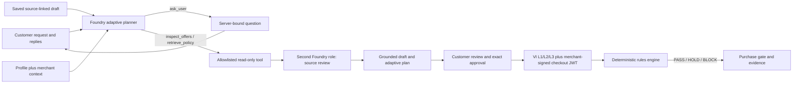

# Adaptive intent engine

This document describes the implemented conversation contract after the
field-questionnaire revision. It is an implementation description, not a
claim that a language model understands every request correctly.

## The decision loop

The shared loop is the same across domains. A domain supplies a profile, a
read-only fact adapter, merchant policy context, and signed offer data; it does not require a
new question script for every field.

The live pipeline reserves two bounded Foundry stages. The first stage
proposes the grounded draft and one next action. The server may execute one
allowlisted, read-only synthetic commerce tool. A ready-for-review draft with grounded flight/hotel search facts requires an offer lookup before the second review pass; the trace labels this harness requirement separately from the model choice. The second stage receives the
original source, the saved draft, the proposed plan, and the tool result as
separate data and reviews them from the source again. This is independent
review by role and input; it is not independent-model corroboration.

The planner action is one of `ask_user`, `inspect_offers`,
`retrieve_policy`, `ready_for_review`, or `review_required`. The model can
generate the next useful question, explain why the answer matters, and choose
whether a customer answer or a merchant fact is needed. A malformed or unsafe
plan fails closed to `review_required`.

## What is shared and what changes by domain

The shared engine carries customer criteria as requirements, preferences, or
ambiguities. Each criterion retains source text, provenance, and a status.
Previously supplied state persists across turns; later customer words can
correct it, while a provider omission cannot erase it. Short replies are
accepted only when they bind to the exact server-issued question contract.
Silence is never consent. An explicit “I do not care” is a recorded choice,
not a hidden default.

The domain adapter changes three things:

- the typed profile and the fields the deterministic validator understands;
- the merchant context, signed facts, and policy schema available to the
  read-only tools; and
- the offer compiler used by the rules engine.

Flights and hotels currently have typed validation profiles. General mode is
conversation-wide and can preserve arbitrary criteria, but its current
deterministic validator supports only the general price field. A new domain
therefore reuses the conversation loop but still needs reviewed field
semantics and trusted facts before a criterion can affect checkout.

Merchant discovery can expose options, policies, and common misunderstanding
topics. That context can help the planner ask a better question or inspect a
fact; it cannot override customer requirements or become a customer source
quote. The synthetic tools return signed checkout facts for read-only preview.

## The trust boundary

The adaptive layer proposes and clarifies. It never approves, signs, decides
liability, or turns model prose into a purchase decision. The customer
approves the exact revision, including supported criteria and visible
unsupported conditions. Approval verifies the revision digest, VI L1/L2/L3
chain, and merchant-signed checkout JWT. Actual checkout still uses only the
deterministic rules engine over approved requirements and verified merchant
facts. Missing or unknown conditions hold the workflow.

Read-only offer previews are not the final approved offer. The final checkout
must be reopened and checked against its exact offer hash; preview facts do not
become purchased facts merely because the model observed them.

## Current evidence and limits

The first three fresh live adaptive cases are retained unchanged in
`evals/experiments/adaptive-first-live-20261014.json`. Strict scoring passed
one of three: the hotel case passed; the flight case captured the intent but
the tool was blocked by one bad field; and the general case asked about a new
delivery condition but returned a wrong price and missed a required flag.
Later diagnostic runs are also preserved. The final fresh live run passed all eight labeled cases in `evals/experiments/adaptive-final-live-20261014.json`, with full case definitions, raw provider proposals, per-stage prompt digests, and actual tool provenance. This is one bounded synthetic run, not an overall accuracy estimate. Earlier failures were not overwritten. Two scorer defects (ambiguous fields counted as already answered, and a non-contiguous decline quotation) and an unnecessary question requirement were corrected explicitly before that final run.

The quality surface separately records eight held-out cases and an
authenticated daily canary. Those results are bounded to the recorded prompt,
model, and synthetic data. They do not establish complete intent
understanding, merchant adoption, fewer disputes, or liability protection.

Live is the standard mode. The offline parser is an explicit emergency mode
for disconnected demonstrations; it is never a silent fallback for a failed
Foundry request.

Both model roles can still omit an arbitrary semantic condition. Source grounding checks what was returned; it does not mathematically prove completeness. The approval screen preserves the original transcript and criteria record, and the customer can add a missed requirement before signing. A red-team API test deliberately omits “quiet” and verifies that adding it during review holds checkout.
