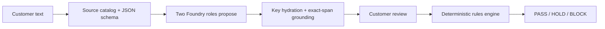

# Source-reference contract

This document records the structured-intent contract introduced in v14 and
refined in v15 after the v13 clarification and hydration failures. It describes the source-reference
boundary, not a guarantee that a model will understand every customer clause.

## Contract

`app/structured_intent.py` defines a strict JSON-schema envelope in which
criteria and questions use stable keys. A key maps either to a registered
profile field or to a generic source ID; each source ID resolves to an exact
contiguous span in the customer message. The server validates the reference
before the proposal can affect the saved draft.

The v14 generic wire is `{key: SOURCEID, kind, status}`. The server derives
the source reference from the validated key, so the model no longer supplies a
second redundant generic reference that can disagree with the key. Profile
criteria require a non-null `source_ref`, except for a missing-required
criterion when no already-captured source exists. That exception is valid only
with `status: needs_clarification` and is checked explicitly. A reference proves
provenance—where the words came from—not
semantics—what the words mean. Dates, money operators, preferences, and
unsupported conditions still require deterministic normalization and reviewed
domain rules.

The v13 live plan used two AI roles, medium reasoning, a 6,000-token maximum
completion, an adaptive 35-second stage bound, and a 90-second function limit;
ordinary stages remained bounded separately at 22 seconds. The v14 repair
retains the two-role boundary and adds no retry, silent fallback, third model
call, or AI approval. The deterministic approval boundary remains the
approved revision, VI chain, merchant-signed facts, and rules engine.

## Provider evidence

The provider-only Valparaíso medium run
`artifacts/planner-v13-valparaiso-medium.json` failed closed with an incomplete
adaptive review and no fallback. The targeted provider diagnostic
`artifacts/planner-v13-valparaiso-provider.json` also failed its city, adult,
and useful-question checks while retaining the foreign-budget distinction.

An expanded medium provider run
`artifacts/planner-v13-valparaiso-medium-expanded.json` passed its five labeled
checks for city, adult, useful question, foreign-currency budget, and retained
conditions. It is a provider experiment, not UI UAT, and does not erase the
failed runs or establish general accuracy.

The v13 source was deployed as commit
`40d65516c5676326372bcc56b7fae8cb474bbb67` in deployment
`dpl_5fShL2wRVkcUXjJJmiHiwxock91Z`, with CI run `38607867597` reporting 529
pytest passes and ten browser suites. Those offline/intercepted browser suites
are distinct from live UI evidence. The v13 headless UI failures and the
limited flight result are recorded in [22 — Messy hidden user testing](22-messy-user-testing.md);
they do not establish complete intent accuracy.

## V13 UI failure checkpoint

The sanitized replay artifact
`artifacts/v13-ui-review-diagnostic-sanitized.json` identified the exact
hydration failure: the second role returned a valid generic `SOURCEID` with
`source_ref: null`, and redundant hydration then rejected the review. The
failure was in the wire contract, not evidence that the customer clause had
been semantically understood. This is why v14 derives the reference from the
validated key and checks the profile exception explicitly.

## V14 contract and release state

The v14 source is commit `fb0dc672a3682a919d6a77ba6fdf0a1009ec2454` and is
READY as deployment `dpl_2vawrdy7ENV83RDqvyz2MAuxvu1a`. The local suite reports
539 pytest passes. CI run `38609247763` reports both jobs successful, including
539 pytest passes and ten browser suites. Fresh post-READY headless UI evidence
is recorded in [22 — Messy hidden user testing](22-messy-user-testing.md).

V14 also adds a read-only draft comparison. The existing `rules_engine` maps a
grounded candidate against verified merchant facts to `MATCH`, `CONFLICT`, or
`UNKNOWN`, with the top state `UNAPPROVED`. The comparison cannot approve a
purchase; the prompt must report actual conflicts. The operations-stage
whitelist now counts adaptive failures instead of ignoring them. These changes
repair the v13 failure boundary. The observed optional-breakfast omission in
the v14 hotel run motivated the v15 repair recorded below; broader release
claims remain bounded by the v15 money usability result and do not imply
perfect accuracy.

## V15 optional-field semantics

The v15 source is commit `f505c4c48203d3f8b4f881c639cc8c43db37aade`, READY as
deployment `dpl_GnMbCwaXUYxyyToc5w8oZQqLf4En`, with prompt
`intent-envelope-v15-explicit-optionals`. The local suite reports 542 pytest
passes. CI run `38610946939` is green: 542 pytest tests in 15.31 seconds, ten
browser suites in 16,566 ms, plus syntax and deadline checks. The public URL is
unchanged.

The backend compiler represents user language such as “optional” and “can
skip” as a sourced, reviewable `None` value with a declined criterion. This
suppresses a repeated optional question without inventing `false` or treating
the model as consent. A later positive answer overrides the decline.
“Cannot skip,” “can't skip,” and “not optional” remain binding. Positive
requirements cannot inherit optional status from another field. The AI prompt
also recognizes nonbinding language, while the schema restricts a null
required criterion to `needs_clarification` when no source was already
captured.

The final two-send Valparaíso hotel run retained the alternate dates, €120
nightly amount, $900 total, balcony, 1 p.m. late checkout, quiet/walkable location,
and adult occupancy. It did not repeat the breakfast question; review showed
Breakfast as `No Preference` sourced to “breakfast optional.” Unsupported
conditions kept the request held, so no hotel approval or purchase occurred.
The live report is `artifacts/messy-hidden-v15-20261014/`.

A root headless v15 money run used one DOM send and reached a terminal state
after 15,053 ms. It produced zero typed fields, assumed neither a flight nor a
`$300` budget, and held the unsupported goal. The assistant said it could only help with flight booking and could not
help obtain money in Florida, rather than asking a clarifying question. There was no error or fallback: this is a
negative hold, but not a useful clarification pass. The report is
`artifacts/root-v15-ambiguous-ui/report.json`.

The v15 flight run completed one live send and passed nine of nine UI checks.
All seven source fields matched; the `$295` matching offer passed and the
`$280` three-connection offer was held with no purchase control. The tester
completed the `$295` simulated purchase, downloaded and reloaded the receipt,
and observed zero exceptions. The first AI answer correctly distinguished the
nonstop offer from the cheaper connecting offer, and review did not re-ask for
airports. The UI evidence is
`artifacts/v15-flight-uat-20261014/final-verification.json`.
Root signature verification reports 14/14 checks passed, including canonical
digest, configured issuer and merchant signatures, VI chain, native
constraints, exact checkout, and approved hash. Verified metadata preserved
`nonstop=true`, economy, one-way, simulated checkout, and the analyst
boundary; signed evidence is 55,951 bytes in
`artifacts/v15-flight-uat-20261014/signed-evidence.json`.

After four live v15 cases (two hotel, one flight, one money), the readback
showed 452 total stages and a 2,392-US-cent ($23.92) application reservation,
which is not an Azure bill. The $30 reservation cap and separate 500-stage ceiling remained unchanged,
with 48 lifetime stages left: 24 full two-stage interpretations. At UTC 2026-10-15 the
daily counter was 4/200 and a fresh session allowed 24 stages. No manual
reset was performed.
No extra AI call was expected from that readback. These accounting limits and
the negative money usability result keep the v15 evidence bounded to the
optional-field repair, the flight receipt path, and the money hold behavior;
they do not establish perfect accuracy.

## Guard behavior

When an exact customer clause is not represented, the narrow guard preserves it
as source-backed unsupported evidence. It may still allow the planner to ask a
question. This protects evidence completeness without inventing a typed value,
claiming semantic understanding, selecting a static fallback question, or
granting approval. The guard is bounded to the explicit money/date identities
it recognizes; it is not a universal semantic-coverage proof.

