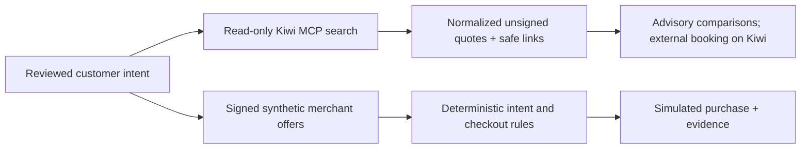

# Live shopping and UAT

This document records the isolated shopping work in the development checkout.
It extends the existing Intent Judge, Verifiable Intent review, and synthetic
signed-commerce flow; it does not replace the approved intent or checkout
boundary.

## Environment separation

| Surface | Location | State | Purpose |
|---|---|---|---|
| Development | `/Users/victor/Nueva-Generacion-dev` · `intent-judge-perfected-dev` · [intent-judge-perfected-dev.vercel.app](https://intent-judge-perfected-dev.vercel.app) | READY, source `af6d617` | Shopping development and exploratory UAT |
| Production | Existing release checkout and `intent-judge-perfected` | v15 deployment `dpl_GnMbCwaXUYxyyToc5w8oZQqLf4En` unchanged | Public demo |

The development project is `prj_BQgv2BqYWbrJjqW0LkPw13cVC8jc`. Development
sessions use `IntentJudgeDev` and distinct signing keys; production keeps
`IntentJudge` and its existing keys. The global AI budget ledger remains the
shared `IntentJudge` table, with a `$30` cap across 500 stages and the current
readback after deployed UAT of 454 stages and a conservative 2,396-cent
($23.96) application reservation. This is not an Azure invoice. The live UAT
used two stages and added four cents to the existing reservation; no usage was
reset. Development has no quality cron.

Runtime source `af6d61744cdecd0e783b1b85fc0b184ffc6825ea` is READY as
`dpl_BJh8nCZZRd4TH495Mk2mYAvY2mw2`.
[Exact-source CI 38663400173](https://github.com/aci-commits4u/Nueva-Generacion/actions/runs/38663400173)
passed both deterministic and browser jobs before the manifest guard allowed
upload. The development `vercel.json` override has no cron. Production was
read back after deployment and still points at `dpl_GnMbCwaXUYxyyToc5w8oZQqLf4En`;
its public health endpoint returned HTTP 200. Production secret bindings were
removed from future previews; its active runtime was not replaced.

## Kiwi discovery boundary

Flights use the official anonymous Kiwi MCP endpoint,
`https://mcp.kiwi.com`, through the pinned MCP SDK version 2.3.0. The
integration exposes one fixed, read-only flight-search tool. It accepts
one-way searches, USD quotes, one to nine adults, approved airport sets,
inclusive date ranges or alternatives, and at most twelve search combinations. Each
request is bounded to 25 seconds, with no automatic call retry and no LLM in
the provider-search step.

The adapter returns at most ten normalized rows with safe HTTPS Kiwi booking
links. Kiwi quotes are unsigned observations: they contain no JWT, cannot
produce PASS, cannot enter the purchase store, and cannot authorize or execute
a purchase. The signed synthetic merchant offer remains the fact source for
Verifiable Intent checkout and evidence. When Kiwi does not provide technical
stop data, `nonstop` is `UNKNOWN`; the adapter does not infer that a flight is
nonstop.

Hotels and General have no live shopping provider in this development work.
They continue to use the shared AI clarification, typed review, signed
synthetic offer, deterministic enforcement, and evidence workflow.

## Verification matrix

| Check | Evidence | Classification | State |
|---|---|---|---|
| Python regression suite | 574 tests passed | Local deterministic/source verification | Pass |
| Existing browser suites | Ten existing suites passed on the current development UI | Deterministic offline/intercepted browser regression | Pass |
| New shopping browser suite | Eleven-suite headless run passed; final shopping suite passed after UI corrections | Deterministic offline/intercepted browser regression | Pass |
| Kiwi SDK search | WAW→BER on Feb 10 returned `$121` and `$127` quotes | Real provider observation | Observed; unsigned and non-purchasing |
| Explicit offline interpretation + live UI search | EWR→MCO on Nov 12 returned ten quotes from `$120` | Offline intent parser followed by the actual Kiwi provider | Observed; live unsigned quotes, no live model interpretation |
| Deployed Foundry → Kiwi walkthrough | One live initial send, all seven requested fields retained, two actual Kiwi quotes | Live model + live provider through DOM typing/clicks; no interception | 18/18 checks passed |
| Development Vercel project | READY deployment, public health HTTP 200, environment development, live AI configured, Azure storage | Hosted deployment | Pass |
| Signed demo purchase | Held offer HTTP 409; matching simulated purchase, download and reload | Signed synthetic checkout through UI | Pass; no real booking |
| Evidence and environment signatures | Configured issuer/merchant signatures, VI chain/native rules, digest/offer/approval binding, distinct dev keys | Root cryptographic verification | 14/14 checks passed |
| Outbound Kiwi landing | Actual View on Kiwi click opened a popup; Kiwi returned HTTP 403 to the automated browser | Real external website, headless browser | Provider access restriction; successful booking-page arrival remains unverified |

The real Kiwi SDK observation and the live UI search both reached Kiwi. The UI
used explicitly offline intent interpretation. Those local checks do not
demonstrate live Foundry interpretation. The separate deployed walkthrough below
does exercise the real model, real discovery, and signed synthetic checkout.

## Deployed live acceptance

At 2026-10-15 01:05 UTC, root typed this into the deployed chatbot once:

> Book me a one-way nonstop economy flight from Warsaw (WAW) to Berlin (BER) on 2027-02-10 under $300.

The real Foundry response completed in 20.9 seconds. It retained WAW, BER,
February 10, nonstop, economy, one-way, and the strict-under-$300 cap
(`29999` cents). Review chose no preference only for unanswered optional fields;
all seven explicit values survived customer approval.

Clicking live search reached Kiwi and returned two USD quotes, `$121` and
`$127`, bound to that intent and approved revision. The browser showed valid
Kiwi links and external/unverified labels; no external quote gained checkout
authority. Mobile width 390 had no horizontal overflow. Missing technical-stop
data remained UNKNOWN despite zero reported connections.

The separate `$280` signed demo itinerary with three connections had no purchase
control, and its gate demonstration returned HTTP 409. The `$295` matching
signed demo itinerary completed a simulated purchase with zero exceptions.
Evidence downloaded and the receipt survived reload. There were no browser
errors, no automatic model retries, and no fallback. This is one successful
live acceptance case, not evidence of universal model reliability.

Artifacts are in `artifacts/dev-hosted-uat/`: `report.json` records 18 UI checks,
`signature-verification.json` records 14 cryptographic checks,
`signed-evidence.json` is 52,933 bytes, and desktop/mobile captures show the
rendered flow. The evidence verifies the configured development keys and proves
they differ from the prior production receipt's keys. No real flight was booked
and no payment was made.

A separate fresh explicit-offline UI walkthrough searched Kiwi, then clicked
the actual first outbound link. It used `target="_blank"` and
`rel="noopener noreferrer"`; Kiwi's destination denied the automated browser
with HTTP 403. The tester did not bypass the restriction or attempt a login,
booking, or payment. `artifacts/uat-shopping/browser-shopping-kiwi-outbound.png`
records the denial. This is not a successful external checkout test, and a
normal customer's booking-page arrival has not been verified here.

## UI direction

The shopping surface keeps the existing software and separation of duties. Its
updated direction is warm neutral with black and orange accents, taking subtle
inspiration from the local Awesome Mastercard reference without using an
official Mastercard logo or claiming affiliation. Stitch authentication was
unavailable for this pass, so there is no generated Stitch artifact. Actual
headless desktop and mobile captures document the locally rendered UI; hosted
verification remains a separate release step.

The browser pass caught a closed airport disclosure after an empty-scope error.
The UI now keeps that control open, preserves the empty selection, and sends no
provider query until at least one airport is chosen. It also tests exact
multiple-airport scope, retry after a visible provider error, stale navigation,
unknown provider fields, safe links, and mobile overflow. Real search results
show two initial options with a native disclosure for the rest, keeping the
signed intent comparison reachable. Evidence is under `artifacts/uat-shopping*`.

## Remaining boundaries

- Kiwi data remains unsigned, read-only, and advisory; it cannot replace the
  merchant-signed checkout facts.
- Hotels and General have no live provider.
- No actual booking, payment, or purchase has been performed.
- Kiwi denied the automated booking-page visit with HTTP 403. The app's real
  quote search works; external booking completion remains unverified.
- Missing Kiwi technical-stop data stays `UNKNOWN`, so a nonstop claim cannot
  be inferred from an incomplete quote.
