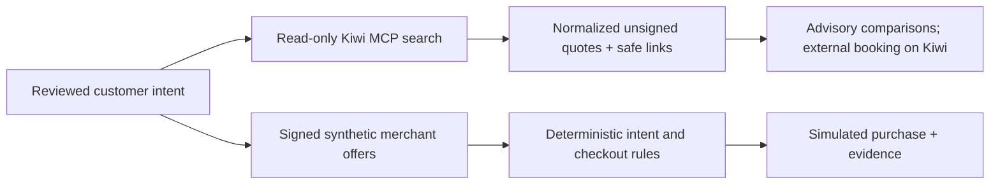

# Live shopping and UAT

This document records the isolated shopping work in the development checkout.
It extends the existing Intent Judge, Verifiable Intent review, and synthetic
signed-commerce flow; it does not replace the approved intent or checkout
boundary.

## Environment separation

| Surface | Location | State | Purpose |
|---|---|---|---|
| Development | `/Users/victor/Nueva-Generacion-dev` · `intent-judge-perfected-dev` · [intent-judge-perfected-dev.vercel.app](https://intent-judge-perfected-dev.vercel.app) | Stable alias, not deployed yet | Shopping development and exploratory UAT |
| Production | Existing release checkout and `intent-judge-perfected` | v15 deployment `dpl_GnMbCwaXUYxyyToc5w8oZQqLf4En` unchanged | Public demo |

The development project is `prj_BQgv2BqYWbrJjqW0LkPw13cVC8jc`. Development
sessions use `IntentJudgeDev` and distinct signing keys; production keeps
`IntentJudge` and its existing keys. The global AI budget ledger remains the
shared `IntentJudge` table, with a `$30` cap across 500 stages and the current
readback of 452 stages and a conservative 2,392-cent ($23.92) application
reservation. Development has no quality cron. No deployment claim is made for
the development alias until its upload and deployed UAT are complete.

## Kiwi discovery boundary

Flights use the official anonymous Kiwi MCP endpoint,
`https://mcp.kiwi.com`, through the pinned MCP SDK version 2.3.0. The
integration exposes one fixed, read-only flight-search tool. It accepts
one-way searches, USD quotes, one to nine adults, approved airport sets,
inclusive date ranges or alternatives, and at most twelve search combinations. Each
request is bounded to 25 seconds, with no automatic call retry and no LLM in
the provider-search step.

The adapter returns at most ten normalized rows with safe HTTPS Kiwi booking
links. Kiwi quotes are unsigned observations: they contain no JWT, cannot
produce PASS, cannot enter the purchase store, and cannot authorize or execute
a purchase. The signed synthetic merchant offer remains the fact source for
Verifiable Intent checkout and evidence. When Kiwi does not provide technical
stop data, `nonstop` is `UNKNOWN`; the adapter does not infer that a flight is
nonstop.

Hotels and General have no live shopping provider in this development work.
They continue to use the shared AI clarification, typed review, signed
synthetic offer, deterministic enforcement, and evidence workflow.

## Verification matrix

| Check | Evidence | Classification | State |
|---|---|---|---|
| Python regression suite | 574 tests passed | Local deterministic/source verification | Pass |
| Existing browser suites | Ten existing suites passed on the current development UI | Deterministic offline/intercepted browser regression | Pass |
| New shopping browser suite | Eleven-suite headless run passed; final shopping suite passed after UI corrections | Deterministic offline/intercepted browser regression | Pass |
| Kiwi SDK search | WAW→BER on Feb 10 returned `$121` and `$127` quotes | Real provider observation | Observed; unsigned and non-purchasing |
| Explicit offline interpretation + live UI search | EWR→MCO on Nov 12 returned ten quotes from `$120` | Offline intent parser followed by the actual Kiwi provider | Observed; live unsigned quotes, no live model interpretation |
| Microsoft Foundry shopping calls | No paid Foundry calls in this phase | Live model verification | Pending |
| Development Vercel project | Stable alias exists, upload not completed | Hosted deployment | Pending |
| Purchase | No actual purchase was made | Commerce boundary | Not performed |

The real Kiwi SDK observation and the live UI search both reached Kiwi. The UI
used explicitly offline intent interpretation. Neither demonstrates live Foundry interpretation, a signed
checkout, or a successful purchase. Root-owned deployment, CI, and Foundry
results can be appended after those checks are actually completed.

## UI direction

The shopping surface keeps the existing software and separation of duties. Its
updated direction is warm neutral with black and orange accents, taking subtle
inspiration from the local Awesome Mastercard reference without using an
official Mastercard logo or claiming affiliation. Stitch authentication was
unavailable for this pass, so there is no generated Stitch artifact. Actual
headless desktop and mobile captures document the locally rendered UI; hosted
verification remains a separate release step.

The browser pass caught a closed airport disclosure after an empty-scope error.
The UI now keeps that control open, preserves the empty selection, and sends no
provider query until at least one airport is chosen. It also tests exact
multiple-airport scope, retry after a visible provider error, stale navigation,
unknown provider fields, safe links, and mobile overflow. Real search results
show two initial options with a native disclosure for the rest, keeping the
signed intent comparison reachable. Evidence is under `artifacts/uat-shopping*`.

## Remaining boundaries

- The development Vercel project is not deployed yet.
- No paid Foundry calls have been made for this phase.
- Kiwi data remains unsigned, read-only, and advisory; it cannot replace the
  merchant-signed checkout facts.
- Hotels and General have no live provider.
- No actual booking, payment, or purchase has been performed.
- Missing Kiwi technical-stop data stays `UNKNOWN`, so a nonstop claim cannot
  be inferred from an incomplete quote.
