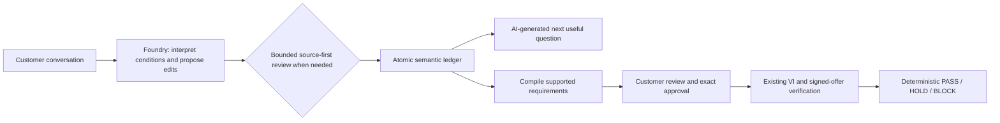

# Transactional intent ledger experiment

2026-10-16. Victor approved implementation of candidate B after the architecture review. This is a dev candidate, not an accepted production architecture. The original proposals and receipts remain historical design artifacts; this file records implementation and observations.

## What changed

The model proposes sourced changes to individual intent records instead of regenerating the entire saved form. The reducer applies a batch atomically against a server-owned revision. An omitted record stays unchanged. Replacements, retractions, explicit no-preference, required conditions, and soft preferences have separate recorded states.

AI owns interpretation, requirement strength, proposed edits, and question selection/wording. Backend logic validates sources, types, revisions, question bindings, and state transitions. It does not use phrase aliases to fill the ledger. The compiler maps supported required predicates to the existing profile validators. Required unsupported meaning stays visible and holds checkout; a soft preference does not become a mandatory checkout rule.

The shared core works across flights, hotels, and general purchases. A profile supplies supported predicates and fact contracts. A new conversational requirement can be recorded without a new profile field. Enforcing it still needs reviewed validation logic and reliable merchant facts. The flight demo remains one-way; round-trip capture is not round-trip checkout support.

The existing merchant-signed facts, exact customer approval, VI adapter, offer-bound exceptions, and purchase recheck remain the authority boundary. Commerce is still simulated except for the existing separate read-only Kiwi discovery. No model can approve a purchase or install a validator.

## Runtime and recovery

- Select B with `AI_PIPELINE_VERSION=ledger`; A remains `adaptive_fast` with its unchanged v19 prompt for comparison.
- Current B prompt: `intent-ledger-v6-readiness-question-contract`.
- Each actual model call reserves against the existing shared allowance. At most two stages run per turn. There is no automatic provider retry or silent offline fallback.
- Review reconstructs from the original customer sources and untouched base ledger; the first candidate is withheld to reduce copying.
- Exact base revision is constrained by the response schema and checked again by the reducer. The model cannot increment or guess it.
- A failed operation/review preserves the last committed draft. Unsupported meaning is distinct from a transport failure.
- Model assertions are labeled unverified. Valid source references prove quotation origin, not semantic entailment.
- Typed airport widgets bind the exact selected set as customer input, even if a model omits that edit.
- Manual review creates a customer-owned ledger revision. It is not credited as correct AI interpretation.
- The approved record and evidence include the ledger digest/revision. Editing revokes approval and offer views.
- Existing conversations remain pinned to their pipeline. Changing the deployment default does not migrate them. Explicit refresh can import an old draft only when all existing non-null fields and flagged requirements retain valid evidence; otherwise it fails without changing state.

No paid service, model deployment, credit limit, production store, or production signing key was added or changed.

## What testing actually found

Fixture-based tests are software-contract checks, not model-quality evidence. Live failures were retained rather than retried into a passing score.

| Evidence | Observation |
| --- | --- |
| Initial live budget calibration | The model returned currency wording as a pricing scope; a typed scope contract replaced that ambiguity. |
| Semantic calibration | “No connections” was expanded into the stronger nonstop predicate. Field semantics, bounded review, and a post-review overlap guard were added. Reviewer agreement alone cannot pass the unresolved overlap. |
| Small paired v3 flight pilot | Both A and B failed an airport-set update. B also made an exclusive budget inclusive. A used 4 actual stages and B used 3. Neither completed the primary task; this is not a superiority result. |
| B airport diagnostic | The EWR/JFK set was semantically correct, but both model stages returned the next revision rather than the base revision. The schema now pins the exact server-owned base revision. |
| Independent v3 browser UAT | Flight had a tester input-escaping error, retained separately from its corrected submission. Hotel dropped neighborhoods and preferences. General shopping retained only the budget. |
| Independent v4 browser regressions | Flight retained more of the complex request and held unsupported constraints; hotel retained location alternatives, quiet-room/late-check-in/parking preferences and scoped budget; general retained hard features, delivery, and soft priorities. Category and some explicit no-preference statements still disappeared. All three failed to ask a useful focused question. |
| v4 timing | Flight 22.907 s, hotel 23.252 s, general 13.998 s, two stages each. These are individual exposed regressions, not p50/p95 estimates. A speed improvement has not been established. |

V5 explicitly addresses category/use-case capture, explicit declines, and answerable required gaps. Prompt assertions do not establish that these fixes work; live v5 results and the activation decision must be recorded below before any release claim.

V5 live checks still failed: general returned 502 after 20.332 s, and a correctly captured BOS/ORD request omitted its date question after 9.751 s. An isolated diagnostic showed that both model stages used `op=no_preference` with `status=active`; the reviewer did capture category and use case. Operation branches now enforce their cross-field status/value/target contract in the response schema. No output normalization substitutes for that validation.

V6 adds controller metadata for missing required fields after trial compilation. A missing useful question triggers the existing bounded second stage; its schema requires a model-written question for the gap. The model can recover a previously missed fact from the source, after which the settled-question guard suppresses the unnecessary question. The backend does not supply question text. Initial v6 calls failed before proposals were returned. The operation schema was then restructured into complete closed nested branches and unavailable target branches were omitted for empty ledgers. These failed calls remain charged to the validation window. Microsoft's [structured-output subset and nested-schema guidance](https://learn.microsoft.com/en-us/azure/foundry/openai/how-to/structured-outputs?view=foundry-classic#json-schema-support-and-limitations) informs compatibility work; generic JSON Schema validation alone does not establish compatibility with this deployed model.

## Evaluation and acceptance limits

`scripts/benchmark_trajectories.py` validates twelve exposed development families offline by default. Live use requires distinct dev A/B endpoints and explicit finite conversation/stage caps. It observes actual session counters, keeps errors, compares exact approvals and ledger bindings, and records raw proposals separately from compiled state.

The first harness review found false-credit bugs. The corrected scorer distinguishes actual false holds, checks source coverage/lineage and trace metadata, avoids cumulative trace double counting, and excludes pending semantic adjudication from primary quality credit. Signed evidence in this HTTP-only harness means token presence plus object/digest binding; it does not claim independent cryptographic signature verification. Application-level VI/signature tests remain separate.

The raw paired pilot and its offline rescore are both retained under ignored `artifacts/`; rescoring made no model calls. None of the exposed examples are a sealed holdout. The larger predeclared family-balanced experiment, ablations, confidence intervals, rare-failure bounds, and production acceptance remain unperformed.

The initial 32-stage internal validation window was explicitly revised to 44 after v5 still failed. This includes failed calls, engineering calibration, paired pilot, and user testing. At the configured 2-cent reservation per stage that is at most 88 cents of additional reservations. Reservations are not Azure billing. The original $30 lifetime ceiling is unchanged; see the amendment in the implementation plan.

## Software verification

- Full deterministic suite: 711 tests passed on v6 source before final delivery.
- Eleven existing headless browser regression suites passed; these use explicit offline/intercepted fixtures and do not establish live inference quality.
- Added ledger readiness/activity rendering check to CI.
- Actual B quality page checked at desktop and 390-pixel mobile width: no page errors or horizontal overflow. A preliminary exact-text locator error was corrected in the test; it was not a product failure.
- Independent code review reproduced the strictness issue, then verified the corrected failure behavior and scoped-money guard.

The quality page labels B experimental and separates historical one-shot benchmark results from whole-conversation evidence. The old one-shot canary is not run or reported as a ledger evaluation.

## Release decision

Pending the final finite v6 user tests after the schema compatibility correction. No source commit, CI result, deployment, or complete live conversation is implied by this candidate record. Production activation requires a separate release decision. C, the bounded discovery-agent challenger, remains unimplemented.

Changing the default back to A affects new requests only. Existing B conversations stay pinned; disabling live AI preserves them but does not constitute a tested deployment rollback. A rollback must account for saved B state and the original deployment. Do not assume an older binary can safely edit the new ledger.
