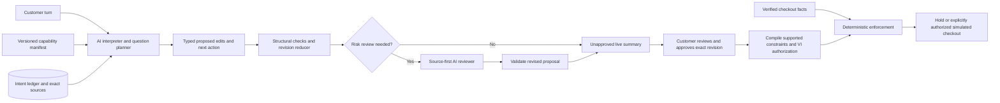

# Recommendation: test an AI intent ledger before adding a research-agent loop

2026-10-16 · **Proposed; no application implementation approved or performed.**

Recommend **B**, a transactional semantic intent ledger with AI-proposed changes and AI-generated next questions. Keep **A**, the actual v19 app, as the control. Test **C**, a bounded capability-discovery agent with a separate source-first critic, as the higher-ceiling challenger. B is a reasoned architectural hypothesis, not a demonstrated winner. If it loses the paired trials, retain A. C should win on question usefulness and transfer, not merely produce more tool traces.

The present app already uses real AI to interpret and ask questions. Its repeated-question failures are not explained by “no AI.” They arise across interpretation, source handling and reconciliation, with incomplete semantic checks. Adding another agent cannot by itself establish what the customer meant.

## Relationship to the original vision and VI

The reusable core should handle arbitrary *intent records and conversations*. A domain integration supplies facts, supported predicates/operators and validators—not a compulsory questionnaire or a new orchestration implementation. AI decides what to ask from the request, unresolved meaning and available evidence. A manifest can prioritize merchant dispute risks, but cannot override a customer's requirement or turn merchant preference into consent.

That closely serves the original transferable AI layer, with one necessary boundary: understanding a new requirement does not create a trustworthy way to verify it. “Quiet hotel” can be captured and clarified generically; claiming it is enforced needs an agreed measurement and reliable facts. Preserve unmet/unsupported meaning visibly and HOLD when required facts or validators are missing.

VI is category-independent authorization/evidence infrastructure, not a shopping or conversational-understanding agent. Its draft built-in constraint vocabulary is extensible; open mandates with unknown constraints must be rejected. Our adapter's explicit custom dispatch is application-specific verification, not universal support by stock VI. See [constraint specification](https://github.com/agent-intent/verifiable-intent/blob/356c29635f1c44df7de02edb58699ca9f29bece6/spec/constraints.md), sections 2, 5–6. AP2 also overlaps on consent/mandates; changing payment protocol does not solve interpretation [AP2 repository](https://github.com/google-agentic-commerce/AP2).

## Three candidates under the same workload

| Design | A — credible incumbent | B — stronger production design, recommended for experiment | C — higher ceiling challenger |
|---|---|---|---|
| Core loop | Full draft proposal → grounding/repair/merge → plan; optional observation/review | AI proposes typed intent edits and one next action → transactional reducer → risk review if needed | B ledger plus AI repeatedly chooses bounded capability/policy/offer queries → source-first critic → question or review |
| AI responsibilities | Draft fields, criteria and question; never approval | Semantic interpretation, scope/corrections, question wording and reason; never approval | Discovery strategy, tool selection, tradeoff/question reasoning; separate critic can challenge omissions, not authorize |
| Deterministic role | Many phrase checks plus profile and signature enforcement | Structural/source-ID checks, operation permissions, invariants, revision CAS, trusted predicate compiler and checkout checks | Same as B plus tool allowlist, budgets, deadline, observation provenance and checkpoint control |
| Context/memory | Customer history, current fields, source catalogue, clock and merchant metadata | Exact immutable turns, active intent records, pending question, relevant source handles; fetch full original turns on demand; no lossy summary as authority | B plus per-tool observations with issuer/time/version and discovery history; critic independently reads original evidence |
| Retrieval | Bounded airport/policy/offer context already exists | Direct versioned capability lookup; lexical identifiers; no vector database justified yet | Allowlisted MCP/API discovery and policy lookup, optionally retrieval when evidence volume warrants it |
| Limits/recovery | adaptive_fast normally 1 call, conditional second; typed errors, session/budget limits | Proposed max 2 model calls/turn; no silent inference retry; invalid edit batch held, prior revision intact, one explicit retry or review | Proposed max 3 model calls + 2 readonly tool executions/turn, 25s turn deadline; exhausting any cap yields honest partial/hold, never fake completion |
| Expected strength | Lowest migration cost; known narrow live successes | Less state loss and more general correction/question reasoning without accumulating phrase patches | Questions informed by actual tradeoffs and merchant capabilities; strongest integration flexibility |
| Main weakness | Semantic repair coupled to profiles and phrase patterns; narrow live evidence | Operation schema can be wrong; reducer cannot judge entailment; risk detector can miss a mistake | Longer tails, correlated model mistakes, injection/exfiltration exposure, tool outages, more maintenance |
| Evidence status | Implemented; finite historical live traces and fresh offline tests | Designed only; no measured quality/latency advantage | Designed only; no measured quality/latency advantage |

A already has tools, review, state, source grounding and concurrency controls. B changes the **contract for evolving intent**, rather than adding those features for the first time. C changes control flow and information acquisition, rather than merely adding a second prompt.

## B: concrete contract and data flow

An illustrative proposed record has stable ID, source turn/span IDs, semantic text, predicate/operator/value if supported, strength (required/preferred), state (active/superseded/needs_clarification), and separate customer approval status. “No preference” is an explicit value/status, not the absence of a record. An unsupported requirement remains a record, not a discarded field.

A proposed edit batch carries `expected_revision`, `add`, `replace`, `retract`, `resolve`, source references and `next_action`. Replacing a cap from $300 to $350 supersedes one record; unrelated airports/dates remain untouched. “Either YYZ or YHM” is one accepted set; no requirement for a single airport is invented. Mutually inconsistent active claims produce an explicit conflict and a targeted question, rather than last-write-wins. Explicit retraction has different semantics from omission.

AI proposes edits; a deterministic reducer checks stable IDs, allowable operation types, provenance existence, types, revision, conflicts and approval invalidation. It cannot certify semantic entailment from a quote. It must not reject ordinary language simply because a regex does not recognize it. Literal parsers remain useful consistency alarms, not a universal interpretation authority. Unsupported predicate/value mapping cannot be invented by a model or compiled into executable code.

The question is model-generated, tied to one unresolved record or a concrete decision risk. Its explanation cites what is unknown and how the answer affects this task. A known/declined field is not a valid target unless new evidence creates a real conflict. Validate record status and repetition deterministically; use AI review for semantic equivalents and risky interpretation. Do not ask an optional preference merely because a field exists in a manifest. If the answer will not change a decision, proceed to review instead.

Risk review triggers (proposed): semantic correction or negation, changed scope/unit/currency, required unsupported condition, source-coverage or question contradiction, high-impact newly inferred value, conflicting observations. A sampled review of nominally low-risk turns estimates detector misses. Reviewer returns a challenged/corrected proposal tied to sources; it does not silently overwrite state. Agreement is evidence, not proof; same-model critics have correlated errors.

Customer review remains an essential gate but must not become a crutch: count missing/misread intent as an AI failure even when the human repairs it. Show unresolved meaning and changes plainly. Initially preserve the existing full review/approval UI; any future diff-only experience still approves a complete canonical snapshot and invalidates prior approval when purchasing meaning changes.

## C: where more agentic behavior could pay off

The agent can inspect an approved merchant's capability manifest, fetch policy definitions, compare bounded offers, and then decide that the meaningful question is about a cancellation deadline rather than a generic hotel preference. A separate critic receives original customer evidence and proposed changes with separated tool data; it checks dropped requirements and harmful assumptions. Context separation reduces one anchoring risk, not correlated model error generally.

MCP is a transport for tool discovery and schemas, not trusted intent or signed merchant truth. The [MCP tool specification](https://modelcontextprotocol.io/specification/2025-11-25/server/tools) supports structured results and treats annotations as untrusted unless the server is trusted. Domain policy and factual evidence need their own provenance and validation. Tools cannot modify consent or call checkout. Keep customer data out of search arguments except necessary, explicitly disclosed parameters.

Use existing FastAPI/Azure Tables for B. For C, evaluate Microsoft Agent Framework for Foundry/tool integration versus LangGraph for explicit checkpoints/interruptions; do not migrate just for their names. [Agent Framework](https://learn.microsoft.com/en-us/agent-framework/overview/) supplies agent/workflow/session integration; [LangGraph persistence](https://docs.langchain.com/oss/python/langgraph/persistence) supplies checkpoints/stores. Neither proves our model will ask better questions. Select a durable runner only if tested multi-step external IO/recovery needs it; checkpoint replay must not duplicate writes or bypass approval.

## Engineering decision criteria

All numeric thresholds below are **proposed acceptance criteria**, not observed results or already agreed requirements. Use hard safety gates before any weighted convenience score.

| Criterion | How judged | Proposed release boundary |
|---|---|---|
| Quality | Complete trajectories: captured meaning, corrections, relevant questions, approval, conflicting offer hold | 100% preservation on the predefined critical subset in the tested sample and zero critical silent loss; all-required-predicate noninferiority to A within a proposed 1-point margin; statistically supported task-success gain. No observed failures is not a guarantee. |
| Question utility | Blind rubric: already answered, irrelevant, unanswerable, decision-changing | ≤2% redundant questions; no forced singleton for an accepted set; C needs measurable utility/turn reduction over B |
| Latency | Actual send-to-usable-validated-answer, cold/warm and failure time | Ordinary p50 ≤6s / p95 ≤12s; enriched C p95 ≤25s; report missed targets rather than weakening them silently |
| Cost | Billed inference/tool cost per successful whole conversation, including failed attempts and reviews | Must fit reconciled remaining allowance; no numeric unit-cost claim before applicable price verified |
| Reliability | Recovery after timeout, stale revision, reload, duplicate submit; repeated trials | Zero state/approval corruption; proposed false-HOLD ≤2% on eligible satisfiable trajectories and positive-completion noninferiority to A within 1 point; report all trials and failures |
| Security | Adversarial tool/policy/customer text and unauthorized calls | Zero unauthorized side effects, fabricated consent, unsigned fact promotion or cross-user disclosure in trial; not a security guarantee |
| Transfer/maintenance | Add an unseen merchant/category using a capability pack; record changed files, tests, engineering time | No core orchestration edits for an already-supported operator; new meaning needs a validator/fact contract, honestly accounted for |

No weighted numeric ranking is justified before B/C measurements. Directionally B best fits current reliability and student-budget constraints; A has lower migration risk; C has more information-gathering upside and the largest operating risk. C should replace B only if its withheld utility/trajectory gain exceeds added latency/cost and security burden. See 06-evals/rubric.md for exact experiment and ablations.

## Four decisions and ownership

| Decision | Verdict | Evidence and dated deferral |
|---|---|---|
| model | OPEN | app/ai_pipeline.py:L845, app/foundry_client.py:L75 and app/foundry_client.py:L143: multiple SDK call sites; consolidate one adapter only after approval. Retain incumbent model for controlled comparisons. 2026-10-16: deployment-specific pricing/lifecycle/quota and better-model performance unknown; delaying leaves model effects unseparated. |
| loop | OPEN | app/ai_pipeline.py:L1259: incumbent bounded loop; app/main.py:L531: snapshot reconciliation. Recommend B vs A/C trial. 2026-10-16: no replacement until approval and paired evidence; delaying keeps known correction risk. |
| trust | MADE | app/main.py:L609, app/main.py:L741, app/main.py:L750; app/vi_adapter.py:L117: retain exact human approval, verified facts, explicit custom dispatch and deterministic purchase checks. Future commercial key/auth/trust arrangements remain OPEN, not covered by this decision. |
| run | OPEN | vercel.json:L5 and app/store.py:L373: bounded function plus atomic budget. 2026-10-16: ordinary API turns stay here; durable C home conditional on measured recovery/deadline needs. Delaying C selection avoids speculative migration but leaves long-run behavior unproven. |

| Plane | Proposed accountable component/role | Boundary |
|---|---|---|
| experience | Product owner Victor; conversation UI component | Visible live intent, errors, questions and exact approval |
| observability | Runtime maintainer; sanitized run/turn trace | Model/prompt/profile versions, tokens, timings, retries, failure classes; not secrets |
| evaluation | Eval maintainer and independent UAT reviewer | Withheld trajectories, immutable scoring, authority checks |
| orchestration | Runtime maintainer; typed reducer and bounded runner | No model approval or unbounded loops |
| tools | Merchant integration maintainer; allowlisted adapters | Read-only discovery, provenance, timeout and egress limits |
| context | Intent-state maintainer; source/ledger store | Customer evidence isolated from merchant/tool data |
| model | AI maintainer; provider adapter and experiment registry | Model selection, structured contract, usage reporting |

These are component/role owners for design; production staffing/on-call assignment beyond Victor is unresolved.

## Exclusions and implementation boundary

Do not add a vector database, reranker, multi-agent team, fine-tuning pipeline, autonomous browser or cross-conversation memory to B without a measured failure they address. Direct lookup suffices for current bounded manifests; exact airport IDs remain deterministic references. Fine-tuning needs a stable contract and enough independently labelled failures first. Streaming progress can improve perceived responsiveness but cannot turn an unvalidated partial draft into authority or reduce actual model latency by itself.

Approval requested first for dev-only B and an isolated evaluation adapter for A/B. C remains a narrowly scoped proposed lab challenger on decision-sensitive tasks, requiring explicit inclusion in the approved implementation scope. No production promotion or paid evaluation is implied. Current public demo and production remain unchanged. Separate real-commerce readiness work includes wallet/customer authentication, partner-issued merchant facts, key custody and operational policies: app/vi_adapter.py:L23 contains synthetic identities and app/main.py:L754 records simulated checkout.

This proposed revision incorporates the independent critique in review.md and corrections in review-response.md. A remains the more operationally mature control; B is not proven cheaper or better. See 04-roi.md for unresolved cost inputs; 05-trust-boundary.proposed.md for corrected trust tracing; 06-evals/rubric.proposed-v2.md for the strengthened experiment protocol. Design completion is not lifecycle verification or product readiness.

Generated by AI Architect · https://www.frankx.ai/ai-architect
